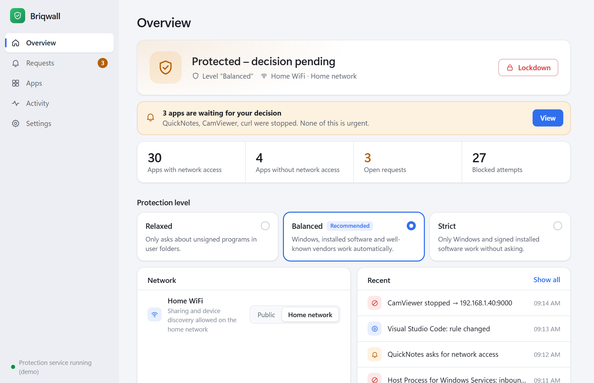
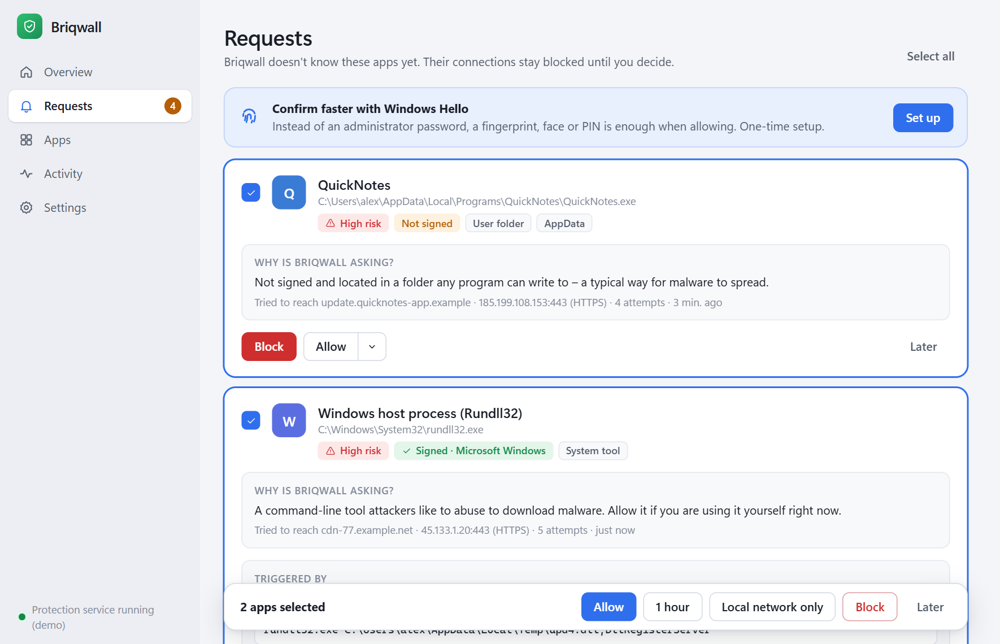
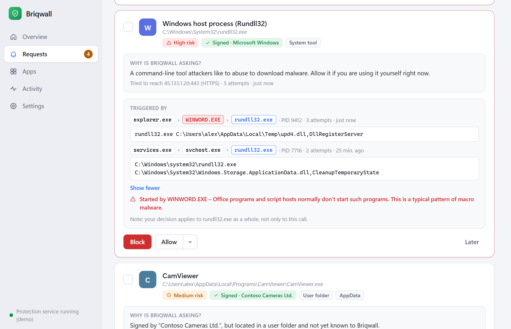
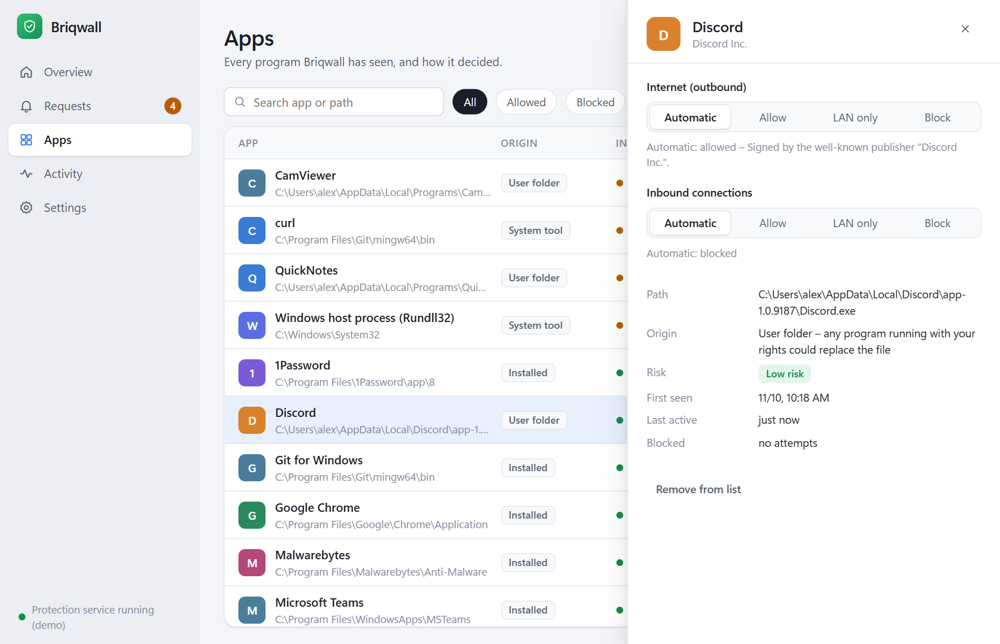
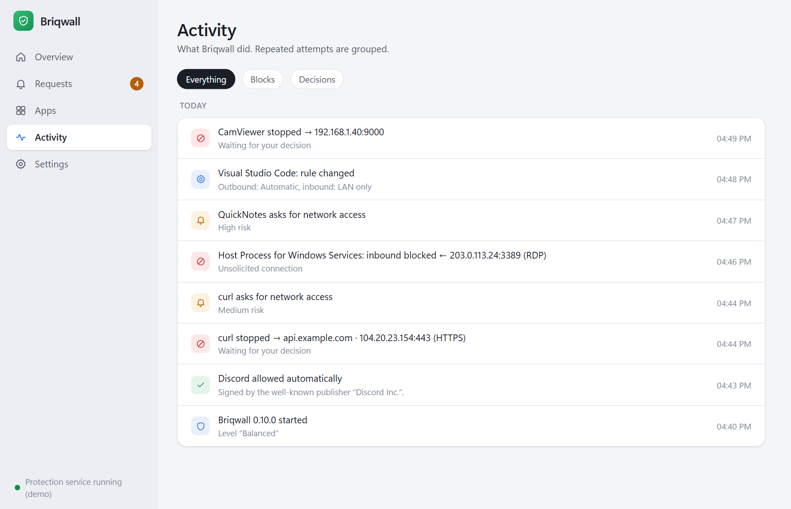
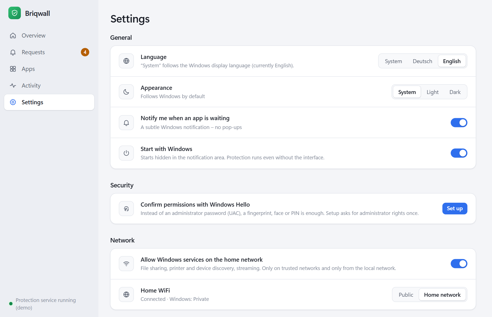
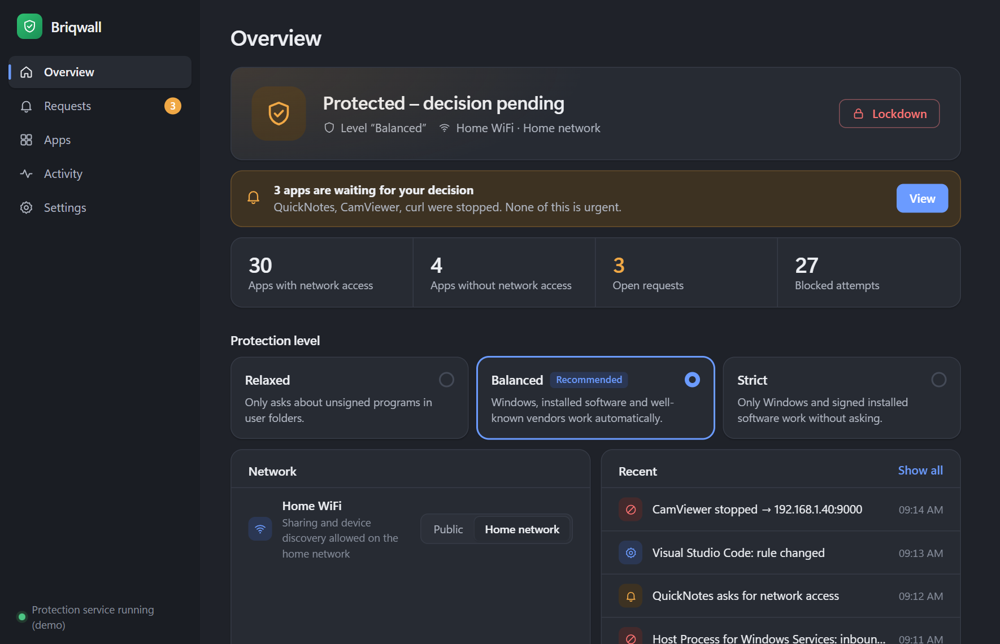

# Briqwall – a Windows firewall you don't have to configure

**English** · [Deutsch](README.de.md)

Briqwall is an application firewall for Windows 10/11 built on the
**Windows Filtering Platform (WFP)**. It consists of a system service
(`briqwall-service.exe`, Rust) and a modern interface (`briqwall.exe`,
Tauri 2 with Svelte 5 and TypeScript) that talk to each other over a secured
named pipe. The interface is available in English and German; it follows the
Windows display language and can be switched in the settings.



## A quick tour

### Overview – everything at a glance

The overview shows whether your PC is protected, which protection level is
active and which network you are on. If apps are waiting for a decision, a calm
banner says so – nothing pops up in your face. **Lockdown** cuts every
connection with a single click (also available from the tray icon), and the
three protection levels are one click away.

### Requests – decide calmly, not under pressure



When Briqwall doesn't know an app yet, its connections stay blocked and the app
appears under **Requests** – with a plain-language explanation of *why*
Briqwall is asking, a risk level, the signature, where the file lives and
which address it tried to reach. The suggested action adapts to the situation:

* **High risk** (unsigned, in a user-writable folder): *Block* is the
  highlighted choice.
* **Frequently abused tools** such as PowerShell or curl: *Allow for 1 hour*,
  after which the door closes again by itself.
* **Target on your home network** (camera, NAS, printer): *Allow local network
  only*.

Select several requests and decide for all of them at once. Allowing is
confirmed with **Windows Hello** (fingerprint, face or PIN) – or with UAC if
Hello isn't set up – so malware running as you cannot approve itself.

### Who triggered it?



Shared tools like `rundll32.exe` or PowerShell are used by Windows itself and
by attackers alike – the name alone doesn't tell you whether a request is
legitimate. Briqwall therefore shows **which process instance** triggered each
blocked attempt: the chain of parent processes and the full **command line**,
which for rundll32 reveals the DLL and function being called. Different callers
are listed separately. If an Office program, PDF reader or script host started
the tool – a classic macro-malware pattern – Briqwall raises a clear warning
and treats the request as high risk.

### Apps – every program and its rule



The app list shows every program Briqwall has seen, where it comes from and
what it may do. Windows components are hidden by default to keep the list
short. Clicking an app opens a details panel: set internet and inbound access
to *Automatic*, *Allow*, *LAN only* or *Block*, and see the reason for the
automatic decision, the signature, the risk and recent blocked attempts. The
list is virtualized and stays fast with hundreds of entries.

### Activity – what happened



A day-by-day log of what Briqwall did: stopped connections, new requests,
automatic decisions, rule changes, network changes. Repeated attempts are
grouped so the log stays readable.

### Settings – few, but meaningful



Language (System / Deutsch / English), appearance (System / Light / Dark),
notifications, autostart, Windows Hello for confirmations, Windows services on
the home network, per-network trust and the list of remembered publishers.

### Light and dark



The interface follows the Windows theme and can also be set manually.

## The core problem – and the compromise

Classic firewalls are stuck in a dilemma:

* **Allowing all outbound traffic** (the Windows default) is convenient but
  does nothing against malware phoning home.
* **Asking about every connection** protects in theory – in practice people
  click “Allow” after the tenth pop-up. That is worse than no protection,
  because it pretends to be safe.

Briqwall solves this by deciding **not by ports and IP addresses, but by where
a program comes from**. The central question is:

> *Could a program without administrator rights have put this file here?*

Software that only an administrator could install (Windows, Program Files,
Store apps) is a deliberate decision by the owner of the PC. An `.exe` that
showed up in `Downloads`, `Temp` or `AppData`, however, could have been put
there by any process – including malware. That is exactly where Briqwall looks
closely. On a typical PC, **~90% of all programs work without a single
prompt**, and the few prompts concern exactly the programs where asking makes
sense.

## What Briqwall does differently

| Idea | Implementation |
|---|---|
| **ACL-based origin instead of path lists** | For every `.exe`, Briqwall evaluates the owner and DACL of the file *and* its folder. If a normal user could modify or replace the file, or plant a DLL next to it, it counts as “user folder”. Well-known gaps like `C:\Windows\Temp` or `spool\drivers\color`, where plain path rules fail, are classified correctly. |
| **LOLBin hardening** | PowerShell, mshta, certutil, rundll32, bitsadmin & co. are genuinely signed by Microsoft, yet attackers use them to download malware. They do *not* get network access automatically (except in “Relaxed” mode). |
| **Asymmetric rights** | Anyone may **tighten** protection instantly (block, lockdown, stricter level). **Loosening** requires proof that a human agreed: either a **Windows Hello signature** (fingerprint, face or PIN; the key lives in the TPM, the service verifies a single-use nonce plus the exact changes) or, as a fallback, a UAC prompt on the secure desktop. Several requests can be confirmed at once. Malware running as the user therefore **cannot unlock itself**, not even through the pipe. |
| **Inbox instead of pop-up floods** | Blocked, unknown apps land in a calm “Requests” list with a plain-language reason, risk level and last target. A subtle Windows notification informs without interrupting. For high-risk apps, “Block” is the highlighted option (nudging towards the safe choice). |
| **Process origin** | WFP net events carry no process id, but the Security audit event 5157 does. For each attempt Briqwall blocked, the service reads the command line and the parent chain of exactly that process (a cache covers short-lived processes). Command lines stay in memory only and are never written to disk. |
| **Temporary permissions** | “Allow for 1 hour” – then Briqwall closes the door by itself. Ideal for PowerShell sessions or installers. |
| **Learning publishers** | Permanently allowing a signed app also allows its updates (which often land in new, versioned folders) and other apps by the same publisher. Can be turned off; the list can be reviewed at any time. |
| **Tamper detection** | When you allow an app, Briqwall remembers its identity (publisher or SHA-256). If the file is replaced afterwards, the permission is suspended and Briqwall asks again. |
| **Network context** | Inbound LAN services (file sharing, casting, device discovery) are only available on trusted networks. On café Wi-Fi the PC is invisible. The classification follows Windows but can be overridden per network with one click. |
| **Fail-closed** | All filters are stored **persistently** in WFP. If the service crashes or is stopped, the last rule set stays active – even across reboots, before the service starts. Rule changes happen in a single WFP transaction; there is never an unprotected moment. |
| **Coexists with the Windows Firewall** | Briqwall uses its own sublayer. In WFP a block in *any* sublayer wins – Briqwall can only add to the Windows Firewall, never weaken it. |

### Protection levels

| Category | Relaxed | **Balanced** (default) | Strict |
|---|---|---|---|
| Windows components | ✅ | ✅ | ✅ |
| Installed + signed | ✅ | ✅ | ✅ |
| Installed, unsigned | ✅ | ✅ | ❓ |
| User folder, well-known publisher | ✅ | ✅ | ❓ |
| User folder, unknown publisher | ✅ | ❓ | ❓ |
| User folder, unsigned | ❓ | ❓ | ❓ |
| Abused Windows tools (LOLBins) | ✅ | ❓ | ❓ |
| Inbound | Windows decides | only Windows services from the LAN, only on trusted networks | everything blocked |

✅ = allowed automatically · ❓ = blocked until you decide. In addition there is
**Lockdown** (everything closed except loopback/DHCP, one click, also in the
tray menu) and **Off**.

## Architecture

```
┌──────────────────────────── User session ───────────────────────────┐
│ briqwall.exe (unprivileged)          briqwall.exe --apply (elevated)│
│  WebView2 (Svelte/TS) · tray · toasts  one change, then exit        │
└──────────────┬───────────────────────────────────┬──────────────────┘
               │ named pipe briqwall-control (JSON, length + payload)
┌──────────────▼───────────────────────────────────▼──────────────────┐
│ briqwall-service.exe (LocalSystem)                                  │
│  ipc_server ─┐                                                      │
│  procmon ────┼──► core (actor, one thread, owns all state)          │
│  net events ─┘      │  policy  (trust decision, pure)               │
│                     │  trust   (ACLs, Authenticode, catalog, SHA-256)│
│                     │  compiler(policy → WFP filters)               │
│                     ▼                                               │
│                wfp.rs ──► BFE / Windows Filtering Platform          │
│                     ALE_AUTH_CONNECT (out) · ALE_AUTH_RECV_ACCEPT (in)│
└─────────────────────────────────────────────────────────────────────┘
```

**Filter layout** in the Briqwall sublayer (higher weight wins):

| Weight | Content |
|---|---|
| 15 | Loopback, DHCP (always allowed, even in lockdown) |
| 14 | Lockdown: block everything |
| 13 | Essential ICMP (PMTU, IPv6 neighbor discovery); echo request stays closed |
| 12 | Explicit per-app block rules |
| 10 | Per-app permissions (anywhere or LAN ranges only) |
| 0 | Default block – “waiting” apps end up here and create a request |

**Proactive evaluation:** A process monitor evaluates every newly started
program *before* its first connection and adds a permission if appropriate.
On first start, all running programs are evaluated before the first rule
build. Blocked attempts come back as WFP net events (`FwpmNetEventSubscribe0`)
and are matched to the rule that caused them. For this, the service enables the
audit subcategories “Filtering Platform Connection/Packet Drop” (failures only);
uninstalling restores them.

**Securing the control channel:**

* Pipe DACL: network logons denied, remote clients rejected; normal users may
  connect but cannot create additional pipe instances (protection against pipe
  squatting / man-in-the-middle). The first instance is created with
  `FILE_FLAG_FIRST_PIPE_INSTANCE`.
* Clients connect with `SECURITY_IDENTIFICATION`: the server may check their
  identity but never act on their behalf.
* Elevation is checked via `ImpersonateNamedPipeClient` + `CheckTokenMembership`.
  Filtered UAC tokens do not count as administrator.
* The data directory `C:\ProgramData\Briqwall` gets a protected DACL
  (SYSTEM/Administrators write, users read).
* The `briqwall:` protocol (clicking a notification) can only open the window,
  never trigger actions – any website could invoke it.
* The service sends **codes, not sentences** (reasons, locations, errors,
  events); the interface translates them. That keeps the protocol language
  independent.

## Installation

Download `Briqwall-<version>-setup-x64.exe` from the releases page and run it.
The installer

* installs for all users into `C:\Program Files\Briqwall` – a location only
  administrators can write to, so nobody can swap the service,
* sets up the firewall service (automatic start, restart on failure),
* updates an existing installation without interrupting protection (the WFP
  filters stay active during the update),
* adopts rules and settings of the predecessor **xWall**,
* speaks English or German depending on Windows,
* can be deployed silently: `Briqwall-<version>-setup-x64.exe /S`.

Uninstall via *Settings › Apps*. This removes the service and all WFP filters;
your rules are kept unless you choose to delete the app data in the uninstall
dialog.

## Building

Requirements: Rust (stable, MSVC toolchain), Node.js 20+, Windows 10/11 with
WebView2 (preinstalled on Windows 11).

```powershell
.\scripts\build.ps1
```

The script type-checks the interface, builds the frontend and the service, runs
all tests (`-SkipTests` to skip) and uses the Tauri CLI to produce the
interface and the installer:

| File | Content |
|---|---|
| `target\release\bundle\nsis\Briqwall_<version>_x64-setup.exe` | Installer |
| `target\release\briqwall.exe` | Interface (frontend embedded) |
| `target\release\briqwall-service.exe` | Firewall service |

Among other things, the tests cover the policy matrix, the filter compiler and
the Windows Hello signature verification, and they check against the real
system that, for example, `notepad.exe` is recognized as protected and signed
while a file in the temp folder counts as user folder.

Note: when compiling, the interface embeds `ui/dist` and the service
(`crates/briqwall-ui/binaries/`). A plain `cargo build` therefore only works
after `build.ps1` has run once.

The installer branding images are generated by
`design\make-installer-images.ps1`.

### Releases (GitHub Actions)

* **CI** (`.github/workflows/ci.yml`): on every push to `main` and on pull
  requests – type check, frontend build, all Rust tests.
* **Release** (`.github/workflows/release.yml`): a tag `v<version>` builds the
  installer and publishes a GitHub release with the installer, a binaries zip
  and `SHA256SUMS.txt`. The tag must match the version in `Cargo.toml`.
  Started manually, it only produces build artifacts for testing.

  ```bash
  git tag v0.2.0
  ```

  ```bash
  git push origin v0.2.0
  ```

* **Code signing (optional):** if the repository secrets
  `WINDOWS_CERTIFICATE` (Base64 of a `.pfx`) and `WINDOWS_CERTIFICATE_PASSWORD`
  are set, the pipeline signs the programs and the installer. Without a
  signature, Windows SmartScreen shows a warning on first start.

### Developing the interface

```bash
npm --prefix ui run dev
```

In a normal browser (`http://localhost:5173`) the interface runs with realistic
**demo data** (`ui/src/lib/mock.ts`), no service needed. Inside `briqwall.exe`
it talks to the service via Tauri commands and events. The Rust side polls the
service once per second and only pushes *changes* to the interface. The app
list is virtualized, so only visible rows are in the DOM. The design follows
Windows 11, the font is Segoe UI Variable, and light/dark follows the system
(switchable). The agreed mock-up lives in `design/mock.html`.

Demo-mode URL parameters help with reviews:
`?lang=en&theme=dark&page=apps&app=Discord&select=2`.

**Translations:** `ui/src/lib/i18n/en.ts` is the reference dictionary; `de.ts`
must contain exactly the same keys – TypeScript enforces this
(`npm --prefix ui run check`). Plurals use `<key>.one` / `<key>.other`,
relative times and dates come from `Intl`. Tray menu, notifications and the
installer follow the same language setting; the service CLI follows the
Windows display language.

**Screenshots** for this README are produced by `node design/screenshots.mjs`
(with `npm --prefix ui run dev` running) from demo data into
`docs/screenshots/`.

### Without the installer

For development or manual deployment: `scripts\install.ps1` in an elevated
PowerShell copies the programs from `target\release` (or from a release's
binaries zip) into `C:\Program Files\Briqwall` and sets up the service. Remove
with `scripts\uninstall.ps1` (`-Purge` also deletes rules and logs).

### Useful commands

| Command | Effect |
|---|---|
| `briqwall-service check <path.exe>` | Shows how Briqwall classifies a file (no admin needed) |
| `briqwall-service reset` | **Emergency:** removes all Briqwall filters immediately |
| `briqwall-service console` | Runs the service in the foreground with log output |
| `briqwall-service uninstall [--purge]` | Removes the service and all WFP objects |

Without administrator rights, `console` runs in **display-only mode**:
evaluation, network detection and the interface work, but no filters are set.
Data then lives in `%LOCALAPPDATA%\Briqwall-dev`.

Log file: `C:\ProgramData\Briqwall\service.log` (German).

## Project structure

```
crates/
  briqwall-common/   Data model, IPC protocol, pipe client
  briqwall-service/  Service
    wfp.rs        WFP wrapper (provider, sublayer, filters, transactions, net events)
    compiler.rs   Policy → filters (with tests)
    policy.rs     Trust decision, LOLBins, well-known publishers (with tests)
    trust.rs      ACL check, Authenticode incl. catalog signatures, version info
    core.rs       State, evaluation, incremental filter updates, IPC logic
    watchers.rs   Process monitor, net event callback, device paths, network list
    ipc_server.rs Secured named pipe
    store.rs      Persistence (atomic), protected data directory, logging
    hello.rs      Verification of Windows Hello signatures (with tests)
    procinfo.rs   Command line and parent chain of blocking-relevant processes
    cli_text.rs   CLI texts (English / German)
  briqwall-ui/       Tauri shell: commands, events, tray, toasts, Hello, elevation, i18n
    installer/    NSIS hooks (set up/remove service, migration) and branding
ui/               Interface (Svelte 5 + TypeScript + Vite)
  src/lib/        Types, API bridge, demo data, state, building blocks
  src/lib/i18n/   Dictionaries (en.ts = reference, de.ts)
  src/pages/      Overview, requests, apps (+ details panel), activity, settings
design/           UI mock-up, app icon (SVG), installer images, screenshot script
docs/screenshots/ Screenshots for this README
scripts/          build.ps1 / install.ps1 / uninstall.ps1
.github/workflows CI and release pipeline
```

## Known limitations & next steps

* **First connection of unknown apps:** Without a kernel callout driver, a
  connection cannot be “held” until the user decides. Unknown apps get an error
  on their first attempt and connect on the next attempt after being allowed.
  A signed WFP callout driver (ALE pend/redirect) would fix this but requires a
  Microsoft driver signature.
* **svchost services** share one app ID. Distinguishing individual services
  (`FWPM_CONDITION_ALE_USER_ID` with the service SID) would be a useful
  extension.
* **Host names** instead of IPs in the activity list (DNS client ETW events)
  would make requests even easier to understand.
* **Code signing:** the release pipeline signs as soon as a certificate is
  stored as a secret. Without one, SmartScreen and UAC show no verified
  publisher.
* **Multiple Windows accounts:** the Hello key belongs to the account that set
  it up. Other accounts confirm via UAC.
* **Emergency:** if something blocks your connection, `briqwall-service reset`
  (as administrator) removes all filters immediately.

## License

Licensed under either of

* Apache License, Version 2.0 ([LICENSE-APACHE](LICENSE-APACHE))
* MIT license ([LICENSE-MIT](LICENSE-MIT))

at your option.

Unless you explicitly state otherwise, any contribution intentionally submitted
for inclusion in this work by you, as defined in the Apache-2.0 license, shall
be dual licensed as above, without any additional terms or conditions.
